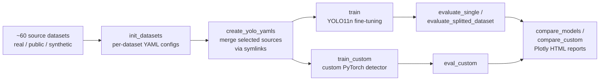

# Person & Forklift Detection in Industrial Environments — YOLO vs. Custom CNN Detector

Master's thesis project (Wrocław University of Science and Technology) focused on **real-time detection of people and forklifts in warehouses and production halls** — a core building block for workplace-safety systems such as collision warning and restricted-zone monitoring.

The repository contains a complete, reproducible experimentation pipeline that:

1. builds training/validation/test sets from **~60 heterogeneous source datasets** (real industrial footage, public datasets and synthetic data),
2. fine-tunes **Ultralytics YOLO11n** and systematically studies the impact of training hyperparameters and data composition,
3. implements, trains and evaluates a **custom object detector written from scratch in PyTorch**,
4. evaluates every model on a shared test set (globally and per source dataset) and generates interactive comparison reports.

---

## Key results

### YOLO11n (fine-tuned)

| Experiment | Best configuration | Precision | Recall | mAP@50 | mAP@50-95 |
|---|---|---|---|---|---|
| Number of epochs (10 → 500) | 300 epochs | 0.978 | 0.960 | 0.984 | **0.879** |
| Batch size (2 → 128) | 64 | 0.970 | 0.962 | 0.983 | 0.870 |
| Input resolution (480 → 960 px) | 960 px | 0.974 | 0.963 | 0.986 | **0.884** |

**Impact of training data source** (same test set, best run per source):

| Training data | mAP@50 | mAP@50-95 |
|---|---|---|
| All sources combined | **0.984** | **0.879** |
| Real industrial footage only | 0.813 | 0.705 |
| Public / internet datasets only | 0.788 | 0.628 |
| Synthetic data only | 0.559 | 0.410 |

**Resolution vs. cost trade-off** (100 epochs, batch 64):

| Input width | mAP@50-95 | Peak GPU memory |
|---|---|---|
| 480 px | 0.817 | 4.5 GB |
| 576 px | 0.842 | 6.5 GB |
| 640 px | 0.855 | 8.0 GB |
| 768 px | 0.874 | 11.6 GB |
| 960 px | 0.884 | 18.2 GB |

Main takeaways:

- Data diversity matters far more than any single hyperparameter: combining real, public and synthetic data increases mAP@50-95 by **+17 pp** over the best single source. Synthetic data on its own does not transfer well to real scenes.
- Training beyond ~300 epochs gives no further gains; batch size has a minor effect for batches ≥ 16.
- Higher input resolution steadily improves accuracy, at the cost of roughly 4× more GPU memory between 480 px and 960 px.

### Custom detector

| Configuration | Precision | Recall | F1 |
|---|---|---|---|
| Batch 16, last 4 backbone layers trainable, 640 px | 0.841 | 0.867 | **0.853** |

The custom network gives a solid baseline for a compact model trained from scratch. The gap to YOLO shows how much modern detectors gain from multi-scale feature fusion, dense anchor-free prediction and large-scale pre-training.

> **Note:** the custom model is evaluated with classification-level precision/recall/F1 on the predicted object slots, so these numbers are **not directly comparable** with YOLO's IoU-based mAP.

Interactive Plotly charts for every experiment are stored in [`tests/`](tests) (`metrics_comparison_*.html`). Download a file and open it in a browser to view the charts.

---

## Methodology



### Data

- **Classes:** `person`, `forklift` (plus a `head` class kept in the label files for compatibility).
- **Sources:** 61 train / 53 val / 45 test sub-datasets, grouped into:
  - **real industrial footage** — recordings from factory and warehouse cameras,
  - **public / internet data** — e.g. Roboflow forklift and workplace sets, TownCentre, crowd-sourced (MTurk) annotation batches,
  - **synthetic data** — NVIDIA-rendered forklifts and cut-and-paste compositions.
- Datasets are combined **without copying any images**: a merged YOLO-format dataset is built from symlinks according to a JSON manifest (see `all_datasets.json`, `test_3_*.json`). This makes it cheap to define new training mixes.
- Every model is tested on the **same held-out test set**. Each test sub-dataset is also evaluated separately, which shows which environments a model handles well or poorly.

> The datasets are not part of this repository (proprietary / licensed data).

### YOLO pipeline

- Model: **YOLO11n** (Ultralytics), fine-tuned from COCO weights, deterministic training (fixed seed).
- Custom training callback that logs **per-epoch GPU memory and epoch time** to CSV.
- Optional SGD / augmentation override configs in [`yolov8_custom_configurations/`](yolov8_custom_configurations).
- Inference latency benchmark (pre-process / inference / post-process breakdown).

### Custom detector (`src/custom_trainer/model.py`)

A single-stage detector designed and implemented from scratch:

- **Backbone:** 5 strided conv blocks (Conv → BatchNorm → LeakyReLU → Dropout2d), 3 → 512 channels, with configurable layer freezing.
- **Detection head:** fully connected trunk with **residual blocks**, then three parallel heads:
  - bounding-box regression (N × 4),
  - class prediction (N × C),
  - objectness confidence (N).
- **Loss:** weighted sum of masked MSE box loss, cross-entropy classification loss with a background class, and confidence loss.
- **Training:** AdamW, OneCycle LR schedule with cosine annealing, gradient clipping, early stopping, photometric augmentations.
- **Inference:** confidence filtering + NMS, an interactive result viewer, and a **live webcam demo** (`live_detection.py`).

### Experiments

| ID | Model | Variable studied |
|---|---|---|
| `test_1` | YOLO11n | number of epochs (10–500) |
| `test_2` | YOLO11n | batch size (2–128) |
| `test_3` | YOLO11n | training data source (real / public / synthetic) × epochs |
| `test_4_resolutions` | YOLO11n | input resolution (480–960 px), GPU memory |
| `test_custom_1` | custom | loss-term weights |
| `test_custom_2`, `test_custom_2_RGB` | custom | epochs, batch size, number of trainable backbone layers |
| `test_custom_3` | custom | input resolution, with and without augmentation |

Each experiment is fully scripted (`tests/<experiment>/*.sh`), so it can be re-run end to end.

---

## Tech stack

**Python ≥ 3.10** · **PyTorch** · **Ultralytics YOLO** · torchvision · OpenCV · scikit-learn · Plotly · Typer (CLI) · Poetry · **Docker (CUDA 12.4)** · Black / isort / flake8 / mypy via pre-commit

---

## Project structure

```
├── src/
│   ├── yolo_trainer/
│   │   ├── pre_train/          # dataset discovery, YAML generation, dataset merging
│   │   ├── train/              # YOLO training with GPU-memory/time logging
│   │   ├── post_train/         # evaluation, per-dataset evaluation, comparison charts, latency benchmark
│   │   ├── calculate_labels_amount.py
│   │   └── remove_symlinks.py  # turn a symlinked dataset into a standalone copy
│   └── custom_trainer/
│       ├── model.py            # custom detector: backbone, head, loss, trainer, inference
│       ├── dataset.py          # YOLO-format PyTorch Dataset
│       ├── train_custom_model.py
│       ├── evaluate_custom_model.py
│       ├── compare_custom_models.py
│       └── live_detection.py   # real-time webcam demo
├── tests/                      # experiment scripts + resulting metrics and HTML reports
├── yolov8_custom_configurations/  # training/augmentation override configs
├── all_datasets.json, test_3_*.json  # dataset manifests (training mixes)
├── compare_models.sh           # batch evaluation + report generation
├── Dockerfile                  # GPU training environment
└── pyproject.toml              # dependencies and CLI entry points
```

---

## Getting started

### Environment

The recommended setup is the provided GPU-enabled Docker image:

```bash
docker build -t thesis-detection .
docker run --gpus all -it -v $(pwd):/app thesis-detection bash
poetry install
```

Or run locally (Python ≥ 3.10):

```bash
poetry install
poetry shell
```

### Typical workflow

```bash
# 1. Index the datasets in datasets/{train,val,test}/ and generate per-dataset configs
init_datasets datasets/

# 2. Build a merged dataset from a manifest
create_yolo_yamls all_datasets.json --output-dir datasets/unitem_all

# 3. Train YOLO
train datasets/unitem_all/train.yaml --epochs 100 --batch-size 64 --image-width 640

# 4. Evaluate on the full test set and per source dataset
evaluate_single datasets/unitem_all/test.yaml \
    --model-path runs/detect/train/weights/best.pt --args-path runs/detect/train/args.yaml
evaluate_splitted_dataset datasets/test/ \
    --model-path runs/detect/train/weights/best.pt --args-path runs/detect/train/args.yaml

# 5. Compare all trained models and generate HTML reports
compare_models runs/detect/ --output-dir comparison/

# 6. Measure inference latency
test_inference_time runs/detect/train/weights/best.pt path/to/images --image-size 640
```

Custom detector:

```bash
train_custom datasets/unitem_all --batch-size 16 --image-size 640 --bacbkone-trainable-layers 4
eval_custom datasets/unitem_all --model-path runs/detect/custom_model/train
compare_custom runs/detect/custom_model --output-dir comparison/custom

# live webcam demo
python -m custom_trainer.live_detection runs/detect/custom_model/train/best.pt --image-size 640
```

All commands are Typer CLIs; run any of them with `--help` to see every option.

---

## Author

**Marcin Dorożyński** — MSc thesis, Wrocław University of Science and Technology (2025)
